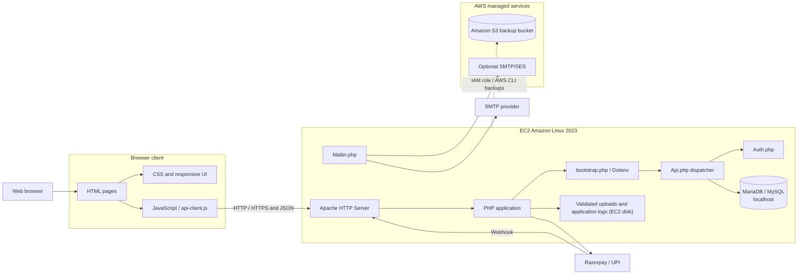
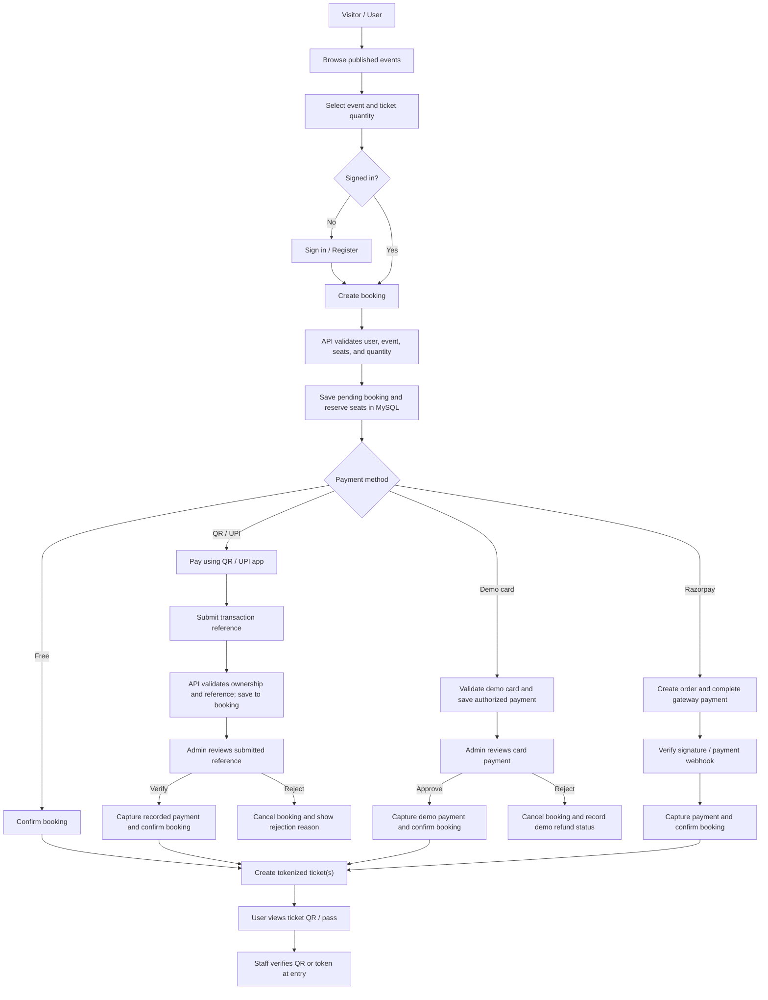
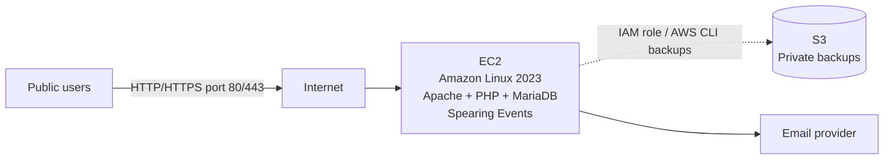

# Spearing Events

Spearing Events is a session-authenticated event discovery, booking, payment, ticketing, notification, review, wishlist, support, and administration platform. The customer-facing pages are implemented in HTML/CSS/JavaScript and communicate with a PHP REST-style API. PHP and MySQL persist users, events, bookings, payments, refunds, tickets, reviews, wishlists, notifications, support requests, and audit/security records. Uploaded event and payment QR images are currently stored on the application server; the application does not currently upload or serve media from S3.

## Table of contents

- [Project overview](#project-overview)
- [Technology stack](#technology-stack)
- [Key features](#key-features)
- [Application architecture](#application-architecture)
- [Request and business flows](#request-and-business-flows)
- [Repository structure](#repository-structure)
- [Local setup](#local-setup)
- [Configuration](#configuration)
- [Database setup and migrations](#database-setup-and-migrations)
- [Run and validation](#run-and-validation)
- [AWS deployment overview](#aws-deployment-overview)
- [Deploy to AWS using EC2 and S3](#deploy-to-aws-using-ec2-and-s3)
- [Post-deployment configuration and operations](#post-deployment-configuration-and-operations)
- [AWS free-tier and cost notes](#aws-free-tier-and-cost-notes)
- [Troubleshooting](#troubleshooting)
- [Security notes](#security-notes)

## Project overview

### User roles

| Role | Primary capabilities |
|---|---|
| Guest | Browse published events and view event details |
| User | Register, sign in, manage profile and password, book events, pay, view tickets, wishlist events, submit reviews, request refunds, and contact support |
| Staff | Check in valid tickets and perform entry verification |
| Admin | Manage events, images, users, bookings, payment settings, refunds, support requests, reports, and entry passes |

### Payment modes

- **UPI/manual verification:** the administrator uploads a payment QR, the customer submits a transaction reference, and an administrator verifies it outside the application.
- **Razorpay:** the application creates an order, verifies signatures, processes payment webhooks, creates tickets, and supports refunds.
- **Demo card:** a hard-coded test card submission waits for admin approval before the booking is confirmed. Admin rejection stores a reason and marks the simulated refund processed; this flow makes no real charge.

Manual UPI submission must not be treated as proof of payment. Free tickets and free bookings can also be processed through the application's booking flow.

## Technology stack

| Layer | Technology |
|---|---|
| Front end | HTML5, CSS3, modern JavaScript |
| Maps | Leaflet and OpenStreetMap/Nominatim |
| Backend | PHP 8.1+ |
| API style | REST-style JSON endpoints routed by `public/api/index.php` |
| Database | MySQL 8 or compatible MariaDB; the AWS guide installs MariaDB on EC2 |
| PHP packages | Composer, vlucas/phpdotenv, PHPMailer, Endroid QR Code, Razorpay SDK |
| Local web/database server | XAMPP, Apache, MySQL |
| AWS application server | Amazon Linux 2023, EC2, Apache HTTP Server, PHP-FPM or Apache PHP module |
| AWS database | MariaDB server on the EC2 instance |
| AWS object storage | Amazon S3 |
| Deployment access | SSH and AWS Systems Manager Session Manager |
| Mail delivery | SMTP provider configured through environment variables |

## Key features

- Email-and-password authentication with CSRF protection, session rotation, login throttling, password reset tokens, and role/status enforcement.
- Event publishing, cancellation, archiving, categories, venue details, coordinates, capacity, ticket prices, and gallery images.
- Booking quantity validation, idempotency keys, seat checks, ticket generation, QR codes, check-in, and entry-pass management.
- Manual UPI/QR payments with admin verification, Razorpay payments, and a demo-only hard-coded card payment flow with admin approval.
- Demo card values: `4242 4242 4242 4242`, expiry `12/30`, and CVV `123`. The cardholder name is prefilled from the signed-in user's profile and can be edited. This test flow does not charge a real card or store card details, and is automatically disabled when `APP_ENV=production`.
- Refund requests, administrator approval/rejection, Razorpay refund processing, and audit records.
- Reviews, wishlists, notifications, support tickets, administrator reports, account suspension, and profile management.
- Payment configuration and QR image management.
- Responsive customer, dashboard, event, ticket, administrator, and authentication pages.

## Application architecture



### Component responsibilities

- `public/`: HTML pages, CSS, browser JavaScript, front controller, and web-facing `.htaccess` rules.
- `public/api/index.php`: Apache entry point for API requests.
- `app/bootstrap.php`: Composer autoloading, environment loading, timezone, error logging, and PHP session initialization.
- `app/Api.php`: route dispatch, validation, payment flows, booking logic, administration operations, tickets, reviews, wishes, notifications, and support requests.
- `app/Auth.php`: sessions, password verification, roles, CSRF, login throttling, account status, and password reset.
- `app/Database.php`: PDO/MySQL connection management.
- `app/Mailer.php` and `app/Support.php`: email delivery and notifications.
- `database/schema.sql`: baseline MySQL schema.
- `database/migrations/`: incremental schema changes.
- `private/`: administrative CLI scripts and background notification delivery.

The current upload implementation writes validated image files beneath `public/uploads/` and records image paths in the local MySQL-compatible database. This is a single-EC2 deployment model. S3 is used for optional database and local-upload backups in the deployment below, not as live application media storage. Moving live uploads to S3 requires updating upload and URL-resolution code; storing files only on EC2 is not durable across instance replacement or suitable for auto scaling without shared storage.

## Request and business flows

### Application flow diagram



### Authentication flow

1. The browser loads a page and requests `GET /api/auth/me`.
2. The API retrieves or initializes the PHP session.
3. Registration validates account details, password rules, and terms acceptance.
4. Login verifies the password, updates security state, and rotates the session.
5. The API returns the current user and CSRF token.
6. State-changing requests include the CSRF token in the `X-CSRF-Token` header.
7. Logout invalidates the session.

### Booking and ticket flow

1. A user opens a published event.
2. The browser sends a booking request with an idempotency key.
3. The server checks authentication, quantity, availability, event state, and transaction rules.
4. The booking and payment record are created in MySQL.
5. For Razorpay, the server creates an order; for UPI, the user submits the provider transaction reference.
6. Payment verification updates payment/booking state.
7. Confirmation creates one tokenized ticket per booked quantity.
8. The user opens the ticket page and staff scan/check in the QR or token.
9. A second check-in is rejected.

### Administrator flow

1. An administrator signs in.
2. The admin page lists or edits events and users.
3. Event changes and booking decisions are authorized through the server-side admin role check.
4. Payment verification, cancellations, publishing, and refunds create audit records and notifications.

## Repository structure

```text
app/                 PHP application classes and API
database/            MySQL schema, seed data, and migrations
docs/                API and authentication documentation
private/             Protected CLI and notification scripts
public/              Static frontend and public API front controller
public/uploads/      Current local validated image uploads
storage/logs/        PHP application logs
storage/uploads/     Reserved private runtime uploads
.env.example         Documented non-secret configuration template
composer.json        PHP dependency and autoload configuration
```

## Local setup

### Prerequisites

- Windows with XAMPP, or Linux/macOS with Apache, PHP, and MySQL
- PHP 8.1 or newer
- PHP extensions: `pdo_mysql`, `gd` (PNG ticket QR generation), `mbstring`, and JSON/openssl support
- Composer 2
- MySQL 8 or a compatible MariaDB release
- Git

### Windows and XAMPP

1. Clone or copy the project under XAMPP:

   ```powershell
   git clone https://github.com/pprajwaldeshpande-tech/spearing_events-main.git C:\xampp\htdocs\spearing_events
   cd C:\xampp\htdocs\spearing_events
   ```

2. Start **Apache** and **MySQL** from the XAMPP Control Panel.

3. Install PHP dependencies:

   ```powershell
   composer install
   ```

4. Create an application database and user in phpMyAdmin, or from the MySQL command line:

   ```sql
   CREATE DATABASE eventspot CHARACTER SET utf8mb4 COLLATE utf8mb4_unicode_ci;
   CREATE USER 'eventspot_app'@'localhost' IDENTIFIED BY 'replace_with_a_long_password';
   GRANT SELECT, INSERT, UPDATE, DELETE ON eventspot.* TO 'eventspot_app'@'localhost';
   FLUSH PRIVILEGES;
   ```

5. Copy `.env.example` to `.env` and update the database and application values.

6. Import the schema:

   ```powershell
   mysql -u root -p eventspot < database/schema.sql
   ```

7. Apply numbered migrations if upgrading an existing database, in numeric order. Do not rerun migrations already applied.

8. Create the first administrator:

   ```powershell
   $env:EVENTSPOT_ADMIN_PASSWORD = Read-Host "Enter admin password"
   php private/create-admin.php admin admin@example.com
   Remove-Item Env:EVENTSPOT_ADMIN_PASSWORD
   ```

9. Enable Apache rewrite support:

   - Allow `.htaccess` overrides in Apache configuration, normally with `AllowOverride All`.
   - Ensure `mod_rewrite` is enabled.

10. Open:

    ```text
    http://localhost/spearing_events/public/
    ```

### Linux/macOS

1. Install Apache, PHP, MySQL, and Composer.
2. Clone the repository and run `composer install`.
3. Copy `.env.example` to `.env`.
4. Create and import the MySQL database:

   ```bash
   mysql -u root -p -e "CREATE DATABASE eventspot CHARACTER SET utf8mb4 COLLATE utf8mb4_unicode_ci;"
   mysql -u root -p eventspot < database/schema.sql
   ```

5. Set the Apache document root to the repository's `public/` directory.
6. Confirm the web server user can write to `storage/logs` and `public/uploads`.

## Configuration

Copy `.env.example`; never commit `.env`.

| Variable | Purpose |
|---|---|
| `APP_ENV` | Application environment, usually `development` or `production` |
| `APP_DEBUG` | Debug display flag; keep `false` in production |
| `APP_URL` | Canonical local/application URL |
| `PUBLIC_APP_URL` | Public HTTPS URL for generated links |
| `APP_TIMEZONE` | PHP timezone, default `Asia/Kolkata` |
| `SESSION_NAME` | PHP session cookie name |
| `SESSION_SECURE` | Set `true` when the complete site uses HTTPS |
| `DB_HOST`, `DB_PORT`, `DB_DATABASE`, `DB_USERNAME`, `DB_PASSWORD` | Database connection |
| `RAZORPAY_*` | Razorpay keys and webhook secret |
| `MAIL_*` | SMTP host, credentials, encryption, and sender identity |

Use a strong database password and a different password for every environment. Store production secrets outside source control. Restrict production `.env` access to the deployment account and Apache; for the ownership shown in the EC2 instructions, use mode `640` (`ec2-user:apache`).

## Database setup and migrations

Import this baseline schema:

```bash
mysql -h <mysql-host> -u <database-admin> -p < database/schema.sql
```

For a new database, `database/schema.sql` is the consolidated baseline; do not replay the historical numbered migrations on top of it. For an older installation, apply only migrations that have not already been applied, in ascending filename order. Current migrations cover:

- Manual UPI payments
- Social profile fields and password reset
- Linkable authentication identities
- Dynamic UPI QR configuration
- Wishlist and venue details
- Demo card payment provider and repair of authorized payments with an empty provider

Additional standalone migration scripts are also provided in `database/`. Review them and use only for existing databases requiring the corresponding feature.

## Run and validation

### Local validation commands

```powershell
composer validate
php -l app/Api.php
php -l app/Auth.php
php -l app/Mailer.php
php -l app/bootstrap.php
```

Functional checks:

1. Register a user and verify password and email validation.
2. Log in, log out, and verify that session rotation works.
3. Request and complete a password reset.
4. Verify unauthenticated and unauthorized administrator API requests are rejected.
5. Publish an event and search/filter it.
6. Attempt booking with the last available seat.
7. Submit a manual UPI reference and verify that only an administrator can confirm it.
8. Test Razorpay with test credentials and test webhook signing.
9. Generate and scan a ticket; confirm a second check-in fails.
10. Test image size/type restrictions and executable-upload rejection.

## AWS deployment overview



### AWS resources

| Resource | Purpose |
|---|---|
| EC2 | Hosts Apache/PHP and the application frontend/API |
| MariaDB on EC2 | Stores transactional application data; accepts local connections only |
| S3 | Stores optional database and local-upload backups; live media integration is not implemented |
| Security groups | Restrict EC2 public traffic; MariaDB is local and port 3306 is not opened |
| IAM role | Recommended identity for application or backup access to S3 |
| Elastic IP | Optional stable public address for DNS while an EC2 instance remains associated |

## Deploy to AWS using EC2 and S3

AWS Console labels and free-tier eligibility can change. Confirm the current offer under **AWS Billing > Free Tier** and avoid production data until eligibility, region, instance class, storage, data transfer, and backup requirements are understood.

**Important:** S3 is object storage, not a PHP web server, so it cannot run this application's backend. The application, Apache, PHP, and MariaDB all run on the EC2 instance; S3 is used for backups and optional release archives only. This single-instance design avoids a separate database service but makes backups and instance storage the operator's responsibility. The repository has no S3 media adapter, so images uploaded by the app are not stored in S3.

### Step 1: Create an S3 bucket

1. Open **S3 > Buckets > Create bucket**.
2. Choose a unique globally unique name such as `spearing-events-prod-<account-id>`.
3. Keep **Block all public access** enabled.
4. Enable default encryption.
5. Enable bucket versioning if database backups are stored there.
6. Create an optional lifecycle rule to expire old backups after 30-90 days, subject to retention needs. If versioning is enabled, configure expiration for noncurrent versions too, or old backup versions may continue to incur storage charges.
7. Do not make uploaded event images publicly accessible unless the application and bucket policy are designed for public delivery through CloudFront or pre-signed URLs.

### Step 2: Create the EC2 security group

1. Create `spearing-events-web-sg`.
2. Add inbound rules:

   | Type | Protocol | Port | Source |
   |---|---|---:|---|
   | SSH | TCP | 22 | Your public IP only, or omit when using Session Manager |
   | HTTP | TCP | 80 | 0.0.0.0/0 |
   | HTTPS | TCP | 443 | 0.0.0.0/0 |

3. Do not expose SSH to `0.0.0.0/0`.

### Step 3: Create an IAM role for S3 access

1. Open **IAM > Roles > Create role > AWS service > EC2**.
2. Create a least-privilege policy scoped to the backup prefix and (if needed) a release-archive prefix. This permits listing, writing, and restoring backups, and downloading release archives, but not deleting objects; use an S3 lifecycle rule for retention:

   ```json
   {
     "Version": "2012-10-17",
     "Statement": [
       {
         "Sid": "SpearingEventsBackupAccess",
         "Effect": "Allow",
         "Action": [
           "s3:PutObject",
           "s3:GetObject"
         ],
         "Resource": "arn:aws:s3:::YOUR-BUCKET-NAME/backups/*"
       },
       {
         "Sid": "ReadSpearingEventsReleaseArchives",
         "Effect": "Allow",
         "Action": "s3:GetObject",
         "Resource": "arn:aws:s3:::YOUR-BUCKET-NAME/releases/*"
       },
       {
         "Sid": "ListSpearingEventsBackups",
         "Effect": "Allow",
         "Action": "s3:ListBucket",
         "Resource": "arn:aws:s3:::YOUR-BUCKET-NAME",
         "Condition": {
           "StringLike": {
             "s3:prefix": ["backups/*", "releases/*"]
           }
         }
       }
     ]
   }
   ```

3. Name the role `spearing-events-ec2-role`.
4. Do not store AWS access keys in `.env` when an EC2 instance role can provide credentials.

### Step 4: Launch an EC2 instance using Amazon Linux

1. Open **EC2 > Instances > Launch instances**.
2. Name the instance `spearing-events`.
3. Choose **Amazon Linux 2023 AMI**, published by Amazon.
4. Select a free-tier-compatible architecture and instance type offered to the account, normally `t2.micro`/`t3.micro` or the current equivalent.
5. Create or select a key pair only if SSH will be used.
6. Under network settings, select the project VPC and subnet.
7. Enable auto-assign public IPv4.
8. Attach `spearing-events-web-sg`.
9. Attach `spearing-events-ec2-role` under IAM instance profile/advanced details.
10. Choose the smallest suitable GP3 root volume shown by the current offer; confirm its size and monthly cost before launch.
11. Optionally add a user-data script to install Apache/PHP after launch.
12. Launch the instance.

### Step 5: Open SSH access safely

Connect with the key pair:

```bash
chmod 400 C:/path/to/spearing-events.pem
ssh -i C:/path/to/spearing-events.pem ec2-user@EC2-PUBLIC-IP
```

Session Manager can be used instead:

1. Attach the AWS managed `AmazonSSMManagedInstanceCore` policy to the EC2 role if Session Manager is desired.
2. Open **EC2 > Instances > Connect > Session Manager**.

### Step 6: Update Amazon Linux and install the application stack

On Amazon Linux 2023:

```bash
sudo dnf update -y
sudo dnf install -y httpd php php-cli php-common php-mysqlnd php-mbstring php-pdo php-gd unzip git mariadb105-server
php -v
httpd -v
```

If PHP packages map to PHP 8.3 or a newer supported Amazon Linux release, confirm `php -v` is PHP 8.1 or newer and enable required extensions:

```bash
php -m | grep -Ei "^(PDO|pdo_mysql|mbstring|gd)$"
```

Configure MariaDB to accept database connections only from this EC2 instance:

```bash
sudo vi /etc/my.cnf.d/99-local-only.cnf
```

Add:

```ini
[mysqld]
bind-address=127.0.0.1
```

Start and enable MariaDB and Apache:

```bash
sudo systemctl enable --now mariadb httpd
sudo systemctl status mariadb httpd --no-pager
sudo ss -lntp | grep 3306
```

Verify the MariaDB listener is `127.0.0.1:3306`, not a public interface. Do not add a port 3306 inbound rule to the EC2 security group.

Install Composer:

```bash
php -r "copy('https://getcomposer.org/installer', 'composer-setup.php');"
php -r "copy('https://composer.github.io/installer.sig', 'composer-installer.sig');"
php -r "if (hash_file('sha384', 'composer-setup.php') === trim(file_get_contents('composer-installer.sig'))) { echo 'Installer verified'; } else { echo 'Installer corrupt'; unlink('composer-setup.php'); exit(1); } echo PHP_EOL;"
sudo php composer-setup.php --install-dir=/usr/local/bin --filename=composer
rm composer-setup.php composer-installer.sig
composer --version
```

### Step 7: Deploy application files

1. Remove any placeholder Apache content if applicable.
2. Clone with a deploy key or deploy from a release archive.
3. Keep application code outside Apache's public root:

```bash
sudo mkdir -p /var/www/spearing-events
sudo chown -R ec2-user:ec2-user /var/www/spearing-events
cd /var/www/spearing-events
git clone https://github.com/pprajwaldeshpande-tech/spearing_events-main.git .
composer install --no-dev --optimize-autoloader
mkdir -p storage/logs storage/uploads public/uploads/payment-qr public/uploads/events
touch storage/logs/.gitkeep storage/uploads/.gitkeep
sudo chown -R ec2-user:apache storage public/uploads
sudo find storage public/uploads -type d -exec chmod 2775 {} \;
sudo find storage public/uploads -type f -exec chmod 664 {} \;
```

If the repository has not been published or the instance cannot access GitHub, upload a release ZIP through S3 and download it using the instance role.

### Step 8: Configure Apache on Amazon Linux

Create `/etc/httpd/conf.d/spearing-events.conf` using `sudo vi`:

```apache
<VirtualHost *:80>
    ServerName YOUR-DOMAIN-OR-EC2-PUBLIC-IP

    DocumentRoot "/var/www/spearing-events/public"

    <Directory "/var/www/spearing-events/public">
        AllowOverride All
        Require all granted
    </Directory>

    <Directory "/var/www/spearing-events">
        Require all denied
    </Directory>

    <Directory "/var/www/spearing-events/public">
        Options -Indexes +FollowSymLinks
    </Directory>

    ErrorLog /var/log/httpd/spearing-events-error.log
    CustomLog /var/log/httpd/spearing-events-access.log combined
</VirtualHost>
```

Allow Apache URL rewriting:

```bash
sudo systemctl restart httpd
sudo httpd -t
sudo httpd -M | grep rewrite
sudo systemctl status httpd --no-pager
```

Check the public directory through a browser at:

```text
http://EC2-PUBLIC-IP/
```

### Step 9: Create the local database and application user

Open the MariaDB administrative shell. On Amazon Linux, the local root account is typically accessed through `sudo` and the Unix socket:

```bash
sudo mariadb
```

Create the database and a restricted application account. Use a unique password and keep it for the `.env` configuration:

```sql
CREATE DATABASE eventspot CHARACTER SET utf8mb4 COLLATE utf8mb4_unicode_ci;
CREATE USER 'eventspot_app'@'127.0.0.1' IDENTIFIED BY 'replace_with_a_long_unique_password';
GRANT SELECT, INSERT, UPDATE, DELETE ON eventspot.* TO 'eventspot_app'@'127.0.0.1';
FLUSH PRIVILEGES;
EXIT;
```

Import the baseline schema as the local database administrator:

```bash
cd /var/www/spearing-events
sudo mariadb < database/schema.sql
```

The schema creates `eventspot` if needed and selects it before creating tables. Do not apply historical numbered migrations to this fresh baseline.

### Step 10: Configure production environment variables

```bash
cd /var/www/spearing-events
cp .env.example .env
sudo chmod 640 .env
sudo chown ec2-user:apache .env
sudo vi .env
```

Use production values:

```dotenv
APP_ENV=production
APP_DEBUG=false
APP_URL=https://events.example.com
PUBLIC_APP_URL=https://events.example.com
APP_TIMEZONE=Asia/Kolkata
SESSION_NAME=spearing_events_session
SESSION_SECURE=true

DB_HOST=127.0.0.1
DB_PORT=3306
DB_DATABASE=eventspot
DB_USERNAME=eventspot_app
DB_PASSWORD=YOUR-APPLICATION-DATABASE-PASSWORD

RAZORPAY_KEY_ID=rzp_live_replace_me
RAZORPAY_KEY_SECRET=replace_me
RAZORPAY_WEBHOOK_SECRET=replace_me

MAIL_HOST=smtp.example.com
MAIL_PORT=587
MAIL_USERNAME=replace_me
MAIL_PASSWORD=replace_me
MAIL_ENCRYPTION=tls
MAIL_FROM_ADDRESS=no-reply@events.example.com
MAIL_FROM_NAME="Spearing Events"
```

The `640` mode lets the deployment user and Apache's `apache` group read the file while denying access to other users. Do not enable live Razorpay until the HTTPS domain, webhook URL, and signature verification have been tested.

### Step 11: Create the first production administrator

```bash
cd /var/www/spearing-events
export EVENTSPOT_ADMIN_PASSWORD='replace_with_a_strong_unique_password'
php private/create-admin.php admin admin@example.com
unset EVENTSPOT_ADMIN_PASSWORD
```

### Step 12: Configure S3 backups

Install the AWS CLI:

```bash
curl -fsSL https://awscli.amazonaws.com/v2/install.sh | sudo bash -s -- --system
aws sts get-caller-identity
aws s3 ls s3://YOUR-BUCKET-NAME/backups/
```

Create and verify a compressed database backup manually on EC2. The command runs with local MariaDB administrative access; use the root-owned scheduled script below for recurring backups:

```bash
sudo mariadb-dump --single-transaction --routines --triggers eventspot \
  | gzip \
  | aws s3 cp - s3://YOUR-BUCKET-NAME/backups/eventspot-$(date +%F-%H%M%S).sql.gz
```

Back up uploaded images separately because the application stores them on the EC2 disk:

```bash
aws s3 sync public/uploads/ s3://YOUR-BUCKET-NAME/backups/uploads/
```

Create `/usr/local/sbin/eventspot-backup` as root:

```bash
#!/usr/bin/env bash
set -euo pipefail
export PATH=/usr/local/bin:/usr/bin:/bin
stamp=$(date -u +%Y%m%dT%H%M%SZ)
cd /var/www/spearing-events
mariadb-dump --single-transaction --routines --triggers eventspot \
  | gzip \
  | aws s3 cp - "s3://YOUR-BUCKET-NAME/backups/eventspot/${stamp}.sql.gz"
aws s3 sync public/uploads/ "s3://YOUR-BUCKET-NAME/backups/uploads/${stamp}/" --only-show-errors
```

Replace the bucket placeholder, then run `sudo chown root:root /usr/local/sbin/eventspot-backup` and `sudo chmod 700 /usr/local/sbin/eventspot-backup`. Add a daily schedule with `sudo crontab -e`, for example `15 2 * * * /usr/local/sbin/eventspot-backup >> /var/log/eventspot-backup.log 2>&1`. The EC2 role supplies S3 credentials; do not create long-lived AWS access keys on the instance or put database passwords in shell commands, cron lines, or source control. Configure S3 lifecycle expiration for these timestamped backup prefixes according to the desired retention period.

The script runs as root, which can authenticate to the local MariaDB administrative account over the Unix socket. To test a restore, download a dump to a temporary test EC2 instance, create the `eventspot` database there, then pipe `gzip -dc` into `sudo mariadb eventspot`. Test restores before relying on backups; do not import test dumps over the live database.

### Step 13: S3 media integration status

The current application writes uploaded images to `public/uploads/` and therefore does **not** yet use S3 for media. Before production auto scaling or instance replacement:

- Add AWS SDK for PHP with Composer.
- Use the EC2 IAM role for S3 credentials.
- Upload payment QR and event images to private or CloudFront-backed bucket prefixes.
- Store the resulting object key or signed/CDN URL in MySQL.
- Update image-serving and QR endpoints to return accessible URLs.
- Add content validation, size limits, malware scanning where appropriate, and lifecycle rules.
- Preserve `.htaccess` executable-file protection locally until S3 URLs replace local files.

For a single EC2 server, the current local upload behavior can be used temporarily, but its files and instance-root disks must be included in backup and replacement procedures.

### Step 14: Domain and HTTPS

1. Register or use a domain hosted in Route 53 or another DNS provider.
2. In **EC2 > Elastic IPs**, allocate an address and associate it with the instance. Check current IPv4 charges and free-tier eligibility first.
3. Add an A record for `events.example.com` pointing to that Elastic IP.
4. Configure HTTPS before setting `SESSION_SECURE=true`. Options include a Let's Encrypt certificate installed on Apache (follow current Certbot instructions for Amazon Linux 2023 and allow inbound port 80 for HTTP-01 validation), or an ACM certificate attached to an Application Load Balancer in front of EC2. An ALB can incur charges and should not be assumed free.

Set Apache virtual-host HTTPS correctly before setting `SESSION_SECURE=true`.

If an Elastic IP is not used, DNS must be updated when the EC2 public address changes.

### Step 15: Configure email and webhook delivery

1. Configure SMTP values in `.env`.
2. Test account creation and password reset.
3. If using SES, verify the sender/domain, request production access if required, and give EC2 SMTP credentials only through the selected secret mechanism.
4. Configure Razorpay webhooks to:

   ```text
   https://events.example.com/api/payments/webhook
   ```

5. Save the exact webhook secret in `RAZORPAY_WEBHOOK_SECRET`.

### Step 16: Schedule notification delivery

Run notification delivery every few minutes:

```bash
crontab -e
```

```cron
*/5 * * * * cd /var/www/spearing-events && /usr/bin/php private/deliver-notifications.php >> /var/www/spearing-events/storage/logs/notifications.log 2>&1
```

Ensure the cron user can access the application `.env` and write to `storage/logs`.

## Post-deployment configuration and operations

### Health checks

```bash
curl -I http://localhost/
curl https://events.example.com/api/auth/me
sudo apachectl -t
sudo systemctl status httpd --no-pager
php -l /var/www/spearing-events/app/Api.php
```

### Log locations

- Apache errors: `/var/log/httpd/spearing-events-error.log`
- Apache access: `/var/log/httpd/spearing-events-access.log`
- PHP application log: `/var/www/spearing-events/storage/logs/php-error.log`
- Notification output: configured in cron

### Application update

```bash
cd /var/www/spearing-events
git pull --ff-only
composer install --no-dev --optimize-autoloader --no-interaction
sudo systemctl reload httpd
```

Back up the database and production media before pulling or applying migrations. Run migrations one at a time and verify output.

### Database backup restore test

Periodically restore an S3 database dump on a temporary test EC2 instance with MariaDB installed. Do not test by importing over the live `eventspot` database. Verify the restored tables and sample application records before relying on the backup. An optional EBS snapshot can help recover the whole instance, but database dumps to S3 remain the portable database backup.

## AWS free-tier and cost notes

- Amazon EC2 free-tier eligibility depends on region, account age, instance family, operating system, and current AWS offer. Confirm from the AWS Billing dashboard before launch.
- The database runs on the EC2 instance and shares its CPU, memory, and disk. EC2 compute, EBS storage/snapshots, S3 storage/requests, and data transfer can each incur charges; confirm current Free Tier or credit eligibility and set a budget.
- S3 has separate storage, request, retrieval, and data-transfer allowances. A private backup bucket can still incur request and storage charges outside its allowance.
- Elastic IPs are normally charged when not attached to a running instance or when additional addresses are allocated.
- Data transfer out, NAT gateways, load balancers, CloudFront, Route 53 hosted zones, and backup exports may not be free.
- Use AWS Budgets with an email threshold and enable billing alerts.
- Stop or terminate unused evaluation resources rather than leaving them running.
- Free-tier eligibility does not replace encryption, least privilege, backups, patching, or HTTPS.

## Troubleshooting

### `500 SERVER_ERROR`

Inspect `/var/log/httpd/spearing-events-error.log` and `storage/logs/php-error.log`. Confirm the PHP extension list and `.env` permissions.

### Database connection failure

- Confirm MariaDB is running: `sudo systemctl status mariadb`.
- Confirm it listens on `127.0.0.1:3306`: `sudo ss -lntp | grep 3306`.
- Confirm `.env` uses `DB_HOST=127.0.0.1`, `DB_DATABASE=eventspot`, and the correct application credentials.
- Confirm the `eventspot_app` account is defined for `127.0.0.1` and has CRUD privileges on `eventspot`.
- Do not open port 3306 in the EC2 security group.

### `403` or `404` on API requests

- Confirm Apache has `AllowOverride All`.
- Confirm `mod_rewrite` or the Amazon Linux Apache rewrite module is loaded.
- Confirm the VirtualHost points to `public/`, not the repository root.
- Inspect `/public/api/.htaccess`.

### Upload failure

- Confirm directory ownership by Apache.
- Confirm the EC2 disk has space.
- Check `public/uploads/payment-qr`, `public/uploads/events`, and `storage/uploads`. The app currently serves uploaded images from EC2; S3 backups do not automatically change their serving URLs.
- Confirm `upload_max_filesize` and `post_max_size` in PHP configuration.

### Sessions fail or users are logged out

- Set a domain-specific canonical `APP_URL` and `PUBLIC_APP_URL`.
- Set `SESSION_SECURE=true` only with HTTPS fully functioning.
- Avoid mixing `www` and non-`www` hostnames.
- Confirm PHP session storage permissions.

## Security notes

- Keep `.env`, `app/`, `database/`, `private/`, `vendor/`, and `storage/` outside the public Apache document root.
- Use HTTPS for production sessions and payment flows.
- Never commit credentials, AWS keys, SMTP passwords, Razorpay secrets, or private certificates.
- Prefer IAM roles and AWS Secrets Manager for production credentials.
- Keep MariaDB bound to `127.0.0.1`; do not open port 3306 in the EC2 security group.
- Keep S3 public access blocked except where an explicitly reviewed public-media architecture is implemented.
- Keep Apache, PHP, Composer dependencies, MariaDB, and OS packages patched.
- Treat email, payment, administrator, and support actions as audited operations.
- Validate all client input and uploaded images server-side.

## Documentation

- API reference: [docs/api.md](docs/api.md)
- Authentication and SMTP configuration: [docs/authentication.md](docs/authentication.md)
